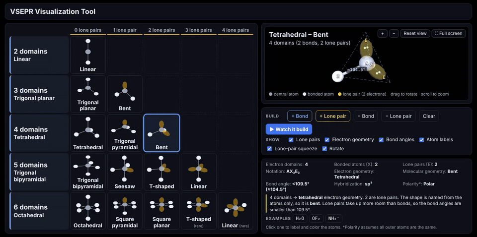
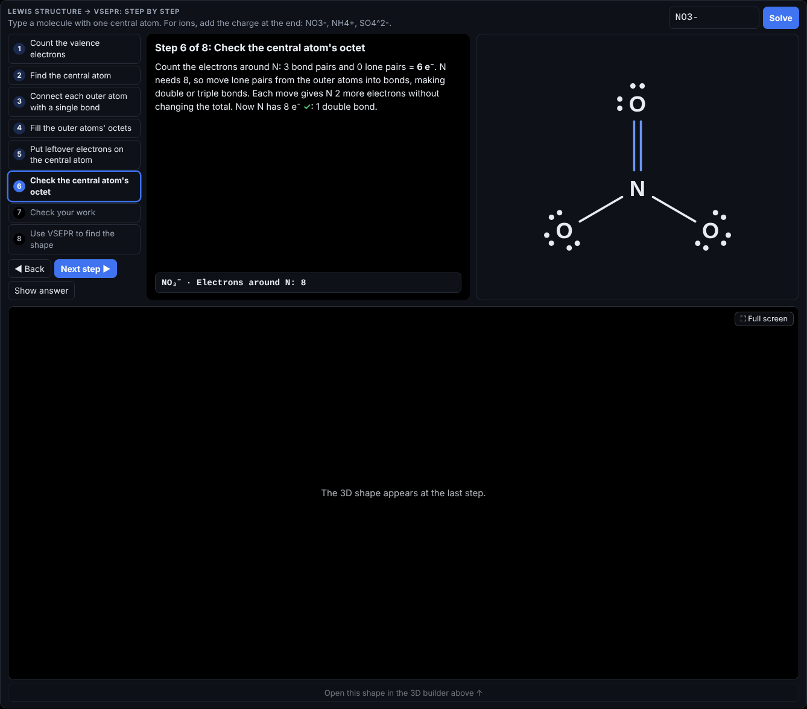

# VSEPR Visualization Tool

An interactive VSEPR chart, 3D molecule builder, and step-by-step Lewis structure solver for high school chemistry. Click any shape to watch it build one electron domain at a time, or type a molecule and follow the Lewis structure method through to its 3D shape.

**Live site:** https://iamclau.github.io/vsepr-visualization-tool/



I teach high school chemistry. Students often memorize VSEPR shape names from a table without seeing *why* a lone pair turns a tetrahedron into a pyramid, or how a Lewis structure leads to a shape. This tool shows the full path: count electrons, draw the Lewis structure, count domains, then see the shape in 3D.

## Features

**VSEPR chart and 3D builder**
- Every VSEPR shape from 2 to 6 electron domains, arranged by domains (rows) and lone pairs (columns), including the rare octahedral cases.
- Click a shape to watch it build: bonded atoms are added one at a time, then lone pairs, and every domain shifts as each one arrives.
- Build your own with **+ Bond** and **+ Lone pair**; the electron geometry and molecular geometry update as you go ("Trigonal Bipyramidal – Seesaw").
- Toggle lone pairs, the electron-geometry outline, bond-angle arcs, atom labels, and a lone-pair "squeeze" that compresses bond angles (CH₄ 109.5° → NH₃ ≈107° → H₂O ≈104.5°).
- Facts for each shape: electron geometry, molecular geometry, bond angles, hybridization, and polarity, plus example molecules with element colors.
- Full-screen 3D for projecting in class.

**Lewis structure → VSEPR solver**

Type a molecule with one central atom (SF4, NO3-, NH4+, SO4^2-…) and step through:
1. Count valence electrons (including the ion charge)
2. Find the central atom (least electronegative; never H)
3. Connect outer atoms with single bonds
4. Fill the outer atoms' octets
5. Put leftover electrons on the central atom
6. Check the central atom's octet, forming double or triple bonds if needed
7. Check the work: electron count, octets, formal charges, resonance, ion brackets
8. Count electron domains: each domain on the central atom is circled and numbered
9. Domains → first name (electron geometry), shown in 3D with ghost spheres where the lone pairs point
10. Bonded atoms (X) vs. lone pairs (E) → second name (molecular shape), e.g. "Trigonal Bipyramidal – Seesaw"

The 2D Lewis drawing updates at every step, with a running electron tally.



## How the solver works

- **Parsing:** reads formulas like `SF4`, `NO3-`, `CO3^2-`, `CO₃²⁻` or `SO4 2-`.
- **Central atom:** the least electronegative atom that appears once (H is never central). Molecules with more than one center (C₂H₆, N₂O, H₂SO₄, HOCl) and radicals with an odd electron count (NO₂) are recognized and explained, not drawn incorrectly.
- **Octet rule first:** electrons are placed exactly as the classroom method does. If the central atom is short of 8, lone pairs move from outer atoms into multiple bonds, with non-halogen atoms and the lowest current bond order chosen first.
- **Exceptions:** B and Al are stable with 6 electrons and Be with 4. Expanded octets are allowed for period 3 and below. When the octet structure leaves a large formal charge on the central atom (e.g. XeO₃), a note explains the expanded-octet alternative some textbooks use.
- **Checks:** total electrons drawn must equal the electrons counted, formal charges must add up to the overall charge, and resonance is flagged when equivalent atoms have different bond orders.

Tested on more than 50 molecules and ions, including CO₂, H₂O, NH₃, SO₂, O₃, NO₃⁻, CO₃²⁻, SO₄²⁻, PO₄³⁻, ClO₄⁻, SF₄, ClF₃, XeF₂, XeF₄, BrF₅, PCl₅, SF₆, I₃⁻, CN⁻, C₂²⁻, N₃⁻, SCN⁻ and BH₄⁻.

## The science and its limits

| What | How it's modeled |
|---|---|
| Domain positions | Ideal geometries for 2–6 domains; lone pairs take equatorial positions (5 domains) and opposite positions (6 domains) |
| Lone-pair squeeze | Domains repel on a sphere with weights lone pair–lone pair > lone pair–bond > bond–bond (1.6 : 1.25 : 1) |
| Angle labels | Textbook values (e.g. ≈107° for NH₃), not the model's computed angles |
| Polarity | Assumes all outer atoms are the same element |

Limits: one central atom only, and the solver follows the octet rule first (some textbooks prefer expanded-octet structures for ions like SO₄²⁻). The 3D shapes show geometry, not real atom sizes or bond lengths.

## Direct links (for slides and handouts)

Add a `#` part to the address to open the tool on a specific shape or molecule:

| Link | Opens |
|---|---|
| `…/vsepr-visualization-tool/#shape=4-1` | The 3D view, filling the window, on 4 domains with 1 lone pair (trigonal pyramidal). The numbers match the chart: domains, then lone pairs. |
| `#shape=4-1&build=1` | The same shape, built one domain at a time |
| `#shape=4-1&full=0` | Selects the shape without filling the window |
| `#solve=PCl3` | The Lewis structure solver, started on PCl₃ (`&step=8` opens step 8, `&step=last` the final step) |

Valid shapes: 2-0, 3-0, 3-1, 4-0, 4-1, 4-2, 5-0, 5-1, 5-2, 5-3, 6-0, 6-1, 6-2, 6-3, 6-4.

## Run it yourself

No install or build step. Download the repository and open `index.html` in a browser. An internet connection is needed for the 3D views (three.js loads from a CDN) and the fonts.

## Project structure

```
index.html        Page layout
css/styles.css    Styling (dark theme, one-screen chart and builder layout)
js/app.js         Shape data, 3D builder, Lewis solver and drawing
docs/             Demo GIF and screenshots for this README
```

## Built with

- Plain HTML, CSS and JavaScript (no framework)
- [three.js](https://threejs.org/) (r128) for the 3D models
- SVG for the 2D Lewis structures

## How I built it

I designed the features, the classroom workflow and the chemistry method, and checked the chemistry against my training and teaching. Claude (Anthropic) wrote most of the code, working from my specifications and feedback from testing with my classes in mind.

## Related

- [Electron Configuration Explorer](https://github.com/iamclau/electron-config-explorer) ([live site](https://iamclau.github.io/electron-config-explorer/)): builds atoms electron by electron with an energy-level diagram and 3D orbitals.

## License

MIT License. See [LICENSE](LICENSE).

**Author:** Ian McLauchlan
